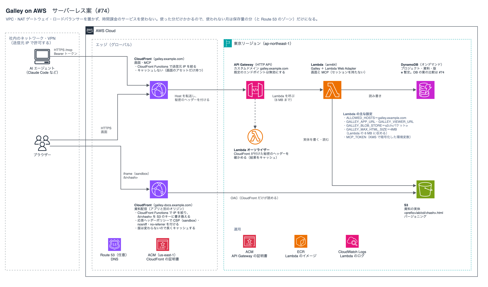

# AWS で動かす

AWS では、画面と MCP を Lambda で動かし、資料は S3 から CloudFront で配ります。VPC は作らず、時間課金のサービスを置きません。構成を決めた経緯と比較は PR #75 の本文にあります。



構成図の元ファイルは `architecture.drawio`（draw.io で開いて直せる。AWS のアイコンは `mxgraph.aws4`）です。

構成はこのフォルダの Terraform で立ち上げます（下の「Terraform で立ち上げる」）。AWS で動かすためのアプリの変更は、まだ途中です（#73）。DB は DynamoDB を使います（`GALLEY_DB=dynamodb://<テーブル名>`。テーブルの形は `docs/design.md` の「DynamoDB のテーブル」）。

## Terraform で立ち上げる

構成図のすべて（CloudFront 2 つ・Lambda@Edge・API Gateway・Lambda・DynamoDB・S3・Cognito・ACM、渡せば Route 53 のレコード）を作ります。Terraform 1.10 以上か OpenTofu 1.10 以上で動きます（以下の `terraform` は `tofu` に読み替えられます）。

- **作らないもの**: Route 53 のホストゾーン、state を置く場所、Cognito の動的なクライアント登録の設定（AWS プロバイダーが未対応。手順の 6 でコンソールから入れる）
- **費用**: 10 人・月 20 日の想定で月 $0.25 ほど（PR #75 の「月額の目安」）。時間課金のサービスは置きません
- **ホスト名**: `app_domain`（例: `galley.example.com`）が画面と MCP、`docs.<app_domain>` が資料配信です。ログインの Cookie は `Domain=<app_domain>` で出すので、`app_domain` とその下のすべてのホストに届きます。**`app_domain` の下には Galley のホストだけを置いてください**。信頼できない別のサービスや、乗っ取られうるサブドメイン（消したサービスを指したままの CNAME など）を置くと、そこからログインの Cookie を読まれたり、偽の Cookie を押し付けられたり（cookie tossing）します

### 置いてあるもの

| ファイル | 内容 |
| --- | --- |
| `versions.tf`・`providers.tf` | Terraform とプロバイダーの版、東京（`region`）と us-east-1 のプロバイダー |
| `variables.tf`・`locals.tf`・`outputs.tf` | 変数・共通の値・出力 |
| `certificates.tf` | ACM の証明書（CloudFront 用は us-east-1、API Gateway 用は `region`）と Route 53 のレコード |
| `cognito.tf` | ユーザープール（Essentials）、マネージドログインのドメイン、ブラウザー用のアプリクライアント、MCP のリソースサーバー |
| `storage.tf` | S3（資料の実体）と DynamoDB |
| `app.tf` | ECR と、アプリの Lambda（arm64・1 GB、Lambda Web Adapter） |
| `api.tf` | API Gateway HTTP API、秘密のヘッダーを確かめる Lambda オーソライザー、`/mcp` の JWT オーソライザー |
| `edge.tf`・`edge/` | ログインを確かめる Lambda@Edge（Node.js、依存パッケージなし） |
| `cloudfront.tf` | CloudFront 2 つ（画面と MCP、資料配信） |
| `authorizer/` | 秘密のヘッダー（`X-Origin-Verify`）を確かめる関数（Node.js） |
| `tests/` | モックのプロバイダーで動かすテスト（`terraform test`。AWS には触らない） |
| `backend.tf.example`・`terraform.tfvars.example` | state の置き場所と変数の例 |

`*.tfstate`・`*.tfvars`・`backend.tf`・`.terraform.lock.hcl` はコミットしません（リポジトリの `.gitignore`）。自分の環境の設定を残すときは、このフォルダを自分のリポジトリにコピーして、そちらでロックファイルと一緒に管理してください。

### 前提

- AWS のアカウントと、IAM・Lambda・CloudFront・Cognito などを作れる権限の認証情報（`aws sts get-caller-identity` で確かめる）
- Terraform 1.10 以上か OpenTofu 1.10 以上、AWS CLI v2、`jq`
- イメージを複製する道具: [crane](https://github.com/google/go-containerregistry/blob/main/cmd/crane/README.md) か [skopeo](https://github.com/containers/skopeo)
- `app_domain` と `docs.<app_domain>` のレコードを作れる DNS。Route 53 のホストゾーンがあれば、レコードまで Terraform が作ります
- ghcr.io に出した Galley のイメージ（Lambda Web Adapter と DynamoDB の adapter が入った版）

### 手順

1. **変数を書く**。state を S3 などに置くなら `backend.tf` も作ります（置かなければ、このフォルダの `terraform.tfstate` に書きます）

   ```bash
   cd deploy/aws
   cp terraform.tfvars.example terraform.tfvars   # app_domain・cognito_domain_prefix などを書き換える
   cp backend.tf.example backend.tf               # state を S3 に置くとき
   terraform init
   ```

   主な変数（すべての変数は `variables.tf`）:

   | 変数 | 既定 | 内容 |
   | --- | --- | --- |
   | `app_domain` | （必須） | 画面と MCP のホスト名 |
   | `cognito_domain_prefix` | （必須） | Cognito のマネージドログインのドメイン（`<接頭辞>.auth.<region>.amazoncognito.com`） |
   | `image_tag` | なし | ECR に複製したイメージのタグ。手順の 2 までは未設定でよい |
   | `route53_zone_id` | なし | Route 53 のホストゾーンの ID。渡せばレコードまで作る |
   | `mfa_configuration` | `ON` | 全員に認証アプリ（TOTP）を求める（初回のログインで設定させる）。インターネットに出す構成なので既定で求める。`OFF` にするとパスワードだけになる |
   | `token_validity_minutes` | `60` | ブラウザーのログインの ID トークンの有効期間（分、5〜1440）。利用者を止めても、持っている ID トークンはこの時間まで使えるので、すぐに止めたいなら短くする（「取り消しの遅れ」） |
   | `deletion_protection` | `true` | ユーザープールと DynamoDB の削除保護。`true` のあいだは、中身のある S3 のバケットも消さない |
   | `noncurrent_version_retention_days` | `30` | S3 で削除・上書きされた資料の実体（古い版）を残す日数（「物理削除のあと」） |
   | `region` | `ap-northeast-1` | Lambda・API Gateway・DynamoDB・S3・Cognito のリージョン |

2. **ECR と証明書だけを先に作る**。Lambda はイメージが ECR に無いと作れず、CloudFront は証明書の検証が済まないと作れないため、ここで止めます（`-target` の警告が出ますが、この段階では想定どおりです）

   ```bash
   terraform apply \
     -target=aws_ecr_repository.app \
     -target=aws_acm_certificate.cloudfront \
     -target=aws_acm_certificate.api
   ```

3. **イメージを ECR に複製する**。Lambda はマルチアーキテクチャのイメージを使えないので（下の「マルチアーキテクチャのイメージ」）、インデックスの中の `linux/arm64` のマニフェストだけを、ダイジェストで指定して複製します。ECR のタグは書き換えられない設定（`IMMUTABLE`）です

   ```bash
   VERSION=v0.1.0
   SOURCE=ghcr.io/yuya-take/galley-docs
   REPO=$(terraform output -raw ecr_repository_url)
   aws ecr get-login-password --region ap-northeast-1 | crane auth login "${REPO%%/*}" -u AWS --password-stdin

   # インデックスの中の linux/arm64 のマニフェストのダイジェスト
   DIGEST=$(crane digest --platform linux/arm64 "$SOURCE:$VERSION")
   crane copy "$SOURCE@$DIGEST" "$REPO:$VERSION"

   # インデックスではなく 1 つのマニフェストになっていることを確かめる
   crane manifest "$REPO:$VERSION" | jq -r '.mediaType, .config.mediaType'
   # application/vnd.oci.image.manifest.v1+json（または application/vnd.docker.distribution.manifest.v2+json）
   ```

   skopeo なら、`--all` を付けずに 1 つのプラットフォームを選んで複製します

   ```bash
   aws ecr get-login-password --region ap-northeast-1 | skopeo login -u AWS --password-stdin "${REPO%%/*}"
   skopeo copy --override-os linux --override-arch arm64 "docker://$SOURCE:$VERSION" "docker://$REPO:$VERSION"
   ```

   間違えてインデックスを複製したときは、`aws ecr batch-delete-image --repository-name <name> --image-ids imageTag=$VERSION` で消してからやり直します。

4. **証明書の検証レコードを作る**（`route53_zone_id` を渡さないときだけ）。次の出力の CNAME を DNS に作ります。渡したときは、手順の 5 で Terraform が作ります

   ```bash
   terraform output acm_validation_records
   ```

5. **全体を作る**。`terraform.tfvars` に `image_tag = "v0.1.0"` を書いて apply します。CloudFront の配置に 10〜20 分ほどかかります。レコードを手で作るときは、証明書の検証が済むまで待ちます（最大 75 分）

   ```bash
   terraform apply
   ```

   `route53_zone_id` を渡さないときは、続けて `terraform output dns_records` の 2 つのレコード（CloudFront への CNAME）を DNS に作ります。

6. **MCP の動的なクライアント登録を有効にする（コンソール）**。MCP クライアント（Claude Code など）が Cognito に自分を登録できるようにします。AWS プロバイダーにこの設定（`UpdateUserPool` の `DcrConfiguration`）がまだ無いため、コンソールで入れます。AWS CLI の `update-user-pool` は、渡さなかったプールの設定を既定に戻してしまうので使いません。Terraform があとでプールを更新しても、この設定は送らないので消えません

   1. Cognito のコンソールで、ユーザープール（`terraform output -raw cognito_user_pool_id`）を開く
   2. 「アプリケーション」の「MCP auth」（Applications > MCP auth）で、「Dynamic client registration settings」の「Edit」を押す
   3. 「Enable open registration」（オープンな登録）を有効にする
   4. 「Open registration grant types」は「Authorization code」だけにする
   5. 「Allowed scopes」に `terraform output -raw mcp_scope` の値（`https://galley.example.com/mcp/access`）を入れて保存する

   有効になったかは、発行元のディスカバリー文書に `registration_endpoint` が出るかで確かめます（有効にした直後はしばらく出ません）

   ```bash
   curl -sS "$(terraform output -raw cognito_issuer)/.well-known/openid-configuration" | jq -r .registration_endpoint
   # https://<接頭辞>.auth.ap-northeast-1.amazoncognito.com/oauth2/register
   ```

   - オープンな登録では、誰でもクライアントを登録できます。ただし登録しただけではトークンは取れず、Cognito の利用者としてログインする必要があります
   - 登録されたクライアントは、ユーザープールのアプリクライアントの上限（既定 1,000）に数えます。増えすぎたら、コンソールのアプリクライアントの一覧から使われていないものを消してください
   - 登録のエンドポイント（`/oauth2/register`）への大量の登録を防ぐには、AWS WAF のレートベースのルールをマネージドログインに付けられます（月額の費用がかかるので、この Terraform には入れていません）
   - 動的に登録されたクライアントには、Cognito の既定の認証の流れ（SRP など）と、既定の有効期間（アクセストークン 60 分）が付きます。変えるときは、コンソールのアプリクライアントの設定で 1 つずつ変えます

7. **利用者を作る**。管理者が作り、招待のメール（仮のパスワード）が届きます。利用者が自分で登録することはできません。最初のログインでパスワードを変え、MFA が `ON`（既定）なら認証アプリ（Google Authenticator など）を登録します

   ```bash
   aws cognito-idp admin-create-user \
     --user-pool-id "$(terraform output -raw cognito_user_pool_id)" \
     --username sato@example.com \
     --user-attributes Name=email,Value=sato@example.com Name=email_verified,Value=true \
     --desired-delivery-mediums EMAIL
   ```

   - Cognito の既定のメールは 1 日 50 通までです。それより多く招待するなら、Amazon SES をつなぎます
   - 辞めた人は `admin-disable-user` で止め、`admin-user-global-sign-out` でリフレッシュトークンを取り消します。ブラウザーに残った ID トークンと MCP のアクセストークンは、期限までは使えます（下の「取り消しの遅れ」）

8. **MCP クライアントを設定する**。設定は URL と更新者名だけで、トークンは配りません。初めて使うときにブラウザーが開き、Cognito にログインします

   ```bash
   claude mcp add --transport http galley "$(terraform output -raw mcp_url)" \
     --header "X-Author-Name: %E4%BD%90%E8%97%A4"
   ```

   Claude Code では、`/mcp` でサーバーを選んで認証します。AWS では `MCP_TOKEN` を使いません（`/mcp` は API Gateway の JWT オーソライザーが Cognito のアクセストークンを確かめます）。日本語の名前は、Docker の構成と同じく UTF-8 をパーセントエンコードした値で入れます（上の例は「佐藤」。リポジトリの README の「AI から登録する（MCP）」）。画面の「AI から登録する」に、ブラウザに保存した名前をエンコードしたコマンドが出ます。

ログアウトは `https://<app_domain>/_auth/signout` です（Cookie を消し、リフレッシュトークンを取り消して、Cognito のログアウトに回します）。アドレスバーに入れるか画面のリンクから開いたときだけすぐにログアウトし、ほかのサイトや資料の iframe から移動させられたとき（`Sec-Fetch-Site` が `same-origin`・`none` 以外）は、「ログアウトする」のリンクを出して押してもらいます。

ログインの画面で、正しいパスワードでもログインできないときは、`cognito.tf` のブラウザー用のクライアントの `explicit_auth_flows` に `ALLOW_USER_SRP_AUTH` を足してください。マネージドログインだけでログインするので外していますが、マネージドログインがこの設定に左右されるかはドキュメントに書かれていません。

### ログインのしくみ

- **画面と資料配信**: 2 つの CloudFront の viewer-request に同じ Lambda@Edge を付け、Cookie の ID トークン（RS256）を確かめます。無ければ Cognito のマネージドログインに回し（認可コード＋PKCE、公開クライアント）、`/_auth/callback` でトークンに換えて Cookie を出します。期限が近づくと、リフレッシュトークンで取り直します（Cookie を出し直すために、同じ URL に 307 で戻します）
- **Cookie**: `galley_id_token`（ID トークン）と `galley_refresh_token`（リフレッシュトークン）。`Domain=<app_domain>; Path=/; Secure; HttpOnly; SameSite=Lax`、期限は 30 日です。アプリには渡しません（CloudFront がアプリに渡す Cookie は `galley_author` だけ）。ログインの途中の PKCE の値は、`galley_login_<state>`（`Path=/_auth/callback`、10 分）に入れ、戻り先でまとめて消します
- **取り直し**: リフレッシュトークンで Cognito を呼ぶのは、リフレッシュトークンの形（文字の種類と長さ）が合い、このプールが出した ID トークン（期限切れでよい。署名は確かめる）も持っているときだけです。偽の Cookie を付けた匿名のリクエストで、Cognito のトークンのエンドポイントを叩かせないため
- **iframe の中**: 資料ビューアの iframe の読み込みでログインが切れていたら、ログインの画面には回さず、「ログインし直してください」の短いページを返します。画面を開き直すとログインの画面に移ります
- **Cognito に届かないとき**: 公開鍵（JWKS）やトークンのエンドポイントに届かなければ、ログインの画面には回さず 503 を返します（回しても同じ理由で失敗するため）。ID トークンがまだ期限内なら、取り直せなくてもそのまま通します。公開鍵は関数の中に持ち続け、知らない鍵（kid）のトークンが来たときだけ取り直します（1 分に 1 回まで）
- **資料配信**: ログインを確かめたあと、`/b/<hash>` を S3 のキー（`<prefix>/ab/cd/<hash>.html`）に書き換えます。`?download=<slug>` は資料の slug の規則に合うときだけ受け付け、origin-response で `Content-Disposition` を付けます。CSP（sandbox）・nosniff・no-referrer は応答ヘッダーポリシーで付け、関数が自分で返す応答には関数でも付けます。ブラウザーへの応答は `Cache-Control: private, max-age=31536000, immutable` にして、途中のキャッシュ（会社のプロキシなど）には置かせません。CloudFront には、キャッシュポリシーの最小 TTL（1 年）でキャッシュさせます
- **MCP**: `/mcp` と `/.well-known/oauth-protected-resource`・`/.well-known/oauth-protected-resource/mcp` には Lambda@Edge を付けません。`/mcp` は API Gateway の JWT オーソライザーが、発行元・`aud`（`https://<app_domain>/mcp`）・スコープ（`https://<app_domain>/mcp/access`）を確かめます
- **CloudFront を通らないアクセス**: API Gateway のカスタムドメインの向き先に直接来たリクエストは、CloudFront が付ける秘密のヘッダー（`X-Origin-Verify`）が無いので、Lambda オーソライザーが断ります。既定の execute-api のエンドポイントは無効です

### 取り消しの遅れ

ID トークンとアクセストークンは、署名と期限だけで確かめます（Cognito に毎回問い合わせない）。そのため、利用者を止めたり消したり、ログアウトしたりしても、すでに持っているトークンは期限まで使えます。

- **ブラウザー**: ID トークンは `token_validity_minutes`（既定 60 分）まで使えます。リフレッシュトークンが取り消されて取り直せなくても、期限内の ID トークンは通します
- **MCP**: アクセストークンは、動的に登録されたクライアントの有効期間（既定 60 分）まで使えます
- **すぐに止めたいとき**: 有効期間を短くします（最短 5 分。ブラウザーは `token_validity_minutes`、MCP のクライアントはコンソールのアプリクライアントの設定）。短くすると、そのぶん Cognito への取り直しが増えます

### 大量のリクエストへの備え

API Gateway にはスロットリング（`api_throttling_rate_limit`・`api_throttling_burst_limit`）を入れていますが、CloudFront と Lambda@Edge には上限を設けていません。ログインしていないリクエストも Lambda@Edge は動くので、大量に送られると Lambda@Edge の費用が増えます。気になるときは、AWS WAF の Web ACL（レートベースのルール）を 2 つの CloudFront に付けられます（Web ACL とルールの月額と、リクエストごとの費用がかかるので、この Terraform には入れていません）。

### 実際の AWS で確かめる

PR #75 の「Terraform の段階で確かめること」です。`APP=galley.example.com`、`DOCS=docs.galley.example.com` として書きます。

1. **Host が転送されてアプリに届く**
   - ブラウザーでログインして画面が開け、資料を登録できること（Host が違うと、アプリの Host の検査が 403 を返します。登録の POST は、CSRF の検査で Origin と Host を比べます）
   - ログインしていなければ Cognito に回ること: `curl -sSI "https://$APP/" | grep -iE '^(HTTP|location)'` が 302 と `https://<接頭辞>.auth...amazoncognito.com/oauth2/authorize?...` を返す
   - CloudFront を通らなければ断られること。API Gateway のカスタムドメインの向き先に直接送ると、秘密のヘッダーが無いので 401、違う値なら 403 になります

     ```bash
     TARGET=$(aws apigatewayv2 get-domain-name --domain-name "$APP" --query 'DomainNameConfigurations[0].ApiGatewayDomainName' --output text)
     IP=$(dig +short "$TARGET" | tail -1)
     curl -sS -o /dev/null -w '%{http_code}\n' --resolve "$APP:443:$IP" "https://$APP/"                              # 401
     curl -sS -o /dev/null -w '%{http_code}\n' --resolve "$APP:443:$IP" -H 'X-Origin-Verify: wrong' "https://$APP/"  # 403
     ```

2. **sandbox の iframe の読み込みに Cookie が付く**: ログインして資料ビューアを開き、資料が表示されること（Cookie が届かなければ「ログインし直してください」になります）。開発者ツールの Network で、`https://$DOCS/b/<hash>` のリクエストに `galley_id_token` の Cookie が付いていることを見ます。登録の画面のプレビューも同じです
3. **資料から `document.cookie` が読めない**: 次の HTML を登録して開くと、`SecurityError` と表示されること。「別タブで開く」で単独で開いても同じです

   ```html
   <!doctype html><meta charset="utf-8"><p id="out"></p>
   <script>
     try { document.getElementById("out").textContent = "読めた: " + document.cookie; }
     catch (e) { document.getElementById("out").textContent = e.name; }
   </script>
   ```

4. **Lambda@Edge が自分で返す応答に CSP が付く**: どちらにも `content-security-policy: sandbox allow-scripts; ...` が付くこと

   ```bash
   HASH=$(printf '%064d' 0)
   curl -sSI "https://$DOCS/b/$HASH"                            # 302（ログインに回す）
   curl -sSI -H 'Sec-Fetch-Dest: iframe' "https://$DOCS/b/$HASH"  # 401（ログインし直してください）
   ```

5. **Claude Code の MCP の OAuth が通る**
   - `curl -sS "https://$APP/.well-known/oauth-protected-resource/mcp" | jq` が `resource`（`https://$APP/mcp`）と `authorization_servers`（Cognito の発行元）を返す
   - `curl -sS -o /dev/null -w '%{http_code}\n' -X POST "https://$APP/mcp"` が 401 を返す
   - 手順の 8 のとおり Claude Code に追加し、`/mcp` から認証してブラウザーでログインできること。続けて `list_projects`・`create_document` を呼べること
   - 通らないとき: 動的なクライアント登録が有効か（手順の 6 の `registration_endpoint`）、アクセストークンの `aud` が `https://$APP/mcp` か（Claude Code が `resource` を送っているか）を確かめます。トークンを持って `/mcp` が 403 になるなら、トークンの `scope` に `https://$APP/mcp/access` が無い（クライアントが `scopes_supported` のスコープを求めていない）ことが考えられます。API Gateway の JWT オーソライザーで断られた理由は、ステージのアクセスログを一時的に有効にすると `$context.authorizer.error` で見られます

### 物理削除のあと

機密を誤って登録したときなどに、資料を完全に消したあとの手順です。`galley purge` は、手元から DynamoDB と S3 に向けて動かします（下の「手元から資料を物理削除する（`galley purge`）」）。`GALLEY_DB` と `GALLEY_BLOB_STORE` の値は `terraform output -raw dynamodb_table_name`（`dynamodb://` を付ける）と `terraform output -raw blob_store` で分かります。

消したあとに、次の 2 つが残ります。

1. **CloudFront のキャッシュ**: 資料配信は 1 年キャッシュするので、消した実体も CloudFront から配られ続けます。キャッシュを無効にします。キャッシュのキーは、Lambda@Edge が書き換えたあとのパス（S3 のキー）なので、`/b/<hash>` ではなく S3 のキーを指定します（末尾の `*` で `?download=` 付きのものもまとめて消えます。`blob_prefix` を変えたときは、`blobs` をその値にします）。月 1,000 パスまでは無料です

   ```bash
   HASH=<消した実体の SHA-256>
   DOCS_ID=$(terraform output -json cloudfront_distribution_ids | jq -r .docs)
   aws cloudfront create-invalidation --distribution-id "$DOCS_ID" \
     --paths "/blobs/${HASH:0:2}/${HASH:2:2}/$HASH.html*"
   # どの実体か分からなければ、すべてを無効にしてもよい（1 パスに数える）
   aws cloudfront create-invalidation --distribution-id "$DOCS_ID" --paths '/*'
   ```

   ブラウザーのキャッシュ（`immutable`）は消せません。既に開いた人のブラウザーには残ります。

2. **S3 の古い版**: バケットはバージョニングを有効にしているので、消した実体も古い版として `noncurrent_version_retention_days` 日（既定 30 日）残り、そのあと自動で消えます。すぐに消したいときは、古い版を指定して消します（`s3:DeleteObjectVersion` の権限が要ります）

   ```bash
   BUCKET=$(terraform output -raw blob_bucket)
   KEY="blobs/${HASH:0:2}/${HASH:2:2}/$HASH.html"
   for kind in Versions DeleteMarkers; do
     aws s3api list-object-versions --bucket "$BUCKET" --prefix "$KEY" \
       --query "${kind}[?Key=='${KEY}'].VersionId" --output text |
       tr '\t' '\n' | grep -v -e '^None$' -e '^$' |
       while read -r version; do
         aws s3api delete-object --bucket "$BUCKET" --key "$KEY" --version-id "$version"
       done
   done
   ```

DynamoDB のポイントインタイムリカバリ（35 日）にも、消す前の資料の情報（タイトル・slug・更新者名など。HTML の本文は S3 にあり、DynamoDB には入りません）が残ります。

### 秘密のヘッダーの入れ替え

CloudFront が API Gateway に付ける `X-Origin-Verify` の値を入れ替えるときは、CloudFront の配置が終わるまで古い値も通します。

1. 今の値を `origin_verify_previous_values` に入れ、値を作り直して apply する

   ```bash
   terraform output -raw origin_verify_value   # この値を terraform.tfvars の origin_verify_previous_values = ["..."] に書く
   terraform apply -replace=random_password.origin_verify
   ```

2. CloudFront の配置が終わったら（`aws cloudfront wait distribution-deployed --id <app の ID>`）、`origin_verify_previous_values` を消して apply する

### 消すとき

1. `terraform.tfvars` に `deletion_protection = false` を書いて `terraform apply` する（ユーザープールと DynamoDB の削除保護を外し、S3 のバケットを中身ごと消せるようにする）
2. `terraform destroy` する。Lambda@Edge は、CloudFront から外れてもレプリカが消えるまで（ふつう数時間）消せないので、`replicated function` のエラーで止まります。時間をおいて、もう一度 `terraform destroy` してください
3. Lambda@Edge が各リージョンに作ったロググループ（`/aws/lambda/us-east-1.<name>-edge-auth`。東京のものは Terraform が消します）は残るので、要らなければ消します

### 注意

- state には秘密のヘッダーの値（`random_password`）が平文で入ります。state の置き場所は、読める人を絞ってください
- CloudFront の標準ログは出していません。出すときは、Cookie を記録しない設定にしてください（ログインのトークンが入るため）
- Lambda@Edge のログは、関数が動いたリージョンの CloudWatch Logs の `/aws/lambda/us-east-1.<name>-edge-auth` に出ます（日本から使えば、ほぼ東京）
- Cognito の発行元は `https://cognito-idp.<region>.amazonaws.com/<プールの ID>` の形（ORIGINAL）です。AWS プロバイダーが発行元の設定（IssuerConfiguration）をまだ扱えないので、既定のままにしています。コンソールで UPDATED に変えると、API Gateway の JWT オーソライザーと MCP のメタデータの発行元が合わなくなります
- `terraform test` は、モックのプロバイダーで apply して、変数と式の組み合わせを確かめます（AWS には触りません）。Lambda@Edge とオーソライザーの関数は `node --test 'deploy/aws/edge/test/*.test.js' 'deploy/aws/authorizer/test/*.test.js'` で確かめます

## Lambda で動かす

Docker の構成と同じイメージを、そのまま Lambda のコンテナイメージとして使います。イメージには [Lambda Web Adapter](https://github.com/aws/aws-lambda-web-adapter) が入っていて、Lambda に届いたリクエスト（API Gateway のイベント）を HTTP のリクエストに直してアプリ（:8080）に渡します。アプリは Lambda かどうかを知らず、Docker と同じ HTTP サーバーのまま動きます。

### イメージに入っているもの

- `/opt/extensions/lambda-adapter`：Lambda Web Adapter（版は `Dockerfile` でタグとダイジェストで固定。上げるときは両方を書き換える）。`/opt/extensions` は Lambda の実行環境だけが読むので、`docker run` では動かず、Docker の構成の動きは変わりません
- `AWS_LWA_PORT=8080`：アダプターがリクエストを渡すポート（`GALLEY_APP_ADDR` の既定と同じ）
- `AWS_LWA_READINESS_CHECK_PROTOCOL=tcp`：アダプターは、アプリが待ち受けを始めたかを確かめてから最初のリクエストを渡します。HTTP で確かめると Host が `127.0.0.1:8080` になり、`ALLOWED_HOSTS` を設定していると Host の検査で断られます（403）。アダプターは既定で 499 までを「準備できた」とみなすので動きはしますが、起動のたびに「許可していないホスト名」の警告がログに出るので、TCP の接続だけで確かめます

### Lambda の関数の設定

| 設定 | 値 | 理由 |
| --- | --- | --- |
| パッケージの種類 | コンテナイメージ（ECR） | Lambda のコンテナイメージは ECR からしか取れない |
| アーキテクチャ | `arm64` | イメージのアーキテクチャと合わせる（下の「マルチアーキテクチャのイメージ」） |
| メモリ | 1024 MB | |
| タイムアウト | 30 秒 | API Gateway HTTP API の統合の上限（30 秒）に合わせる |

環境変数（イメージの既定から変えるもの）:

| 環境変数 | 値 | 理由 |
| --- | --- | --- |
| `GALLEY_DB` | `dynamodb://<テーブル名>` | DB に DynamoDB を使う。認証とリージョンは Lambda の実行ロールと `AWS_REGION`（Lambda が設定する）で決まる |
| `GALLEY_DATA_DIR` | `/tmp` | Lambda で書き込めるのは `/tmp` だけ。DynamoDB と S3 を使えば何も書かないが、既定の `/data` のままだと起動時にディレクトリを作れずに失敗する |
| `ALLOWED_HOSTS` | `galley.example.com` | CloudFront が転送する Host。Host の検査・CSRF の検査・MCP の Host の検査が Docker と同じに通る |
| `GALLEY_APP_URL` | `https://galley.example.com` | MCP が返す資料のリンク |
| `GALLEY_VIEWER_URL` | `https://docs.galley.example.com` | 画面の iframe に入れる資料配信の URL |
| `GALLEY_VIEWER_ADDR` | `127.0.0.1:8081` | 資料配信の待ち受け（下の「資料配信（:8081）」） |
| `GALLEY_MAX_HTML_SIZE` | `4MB` | Lambda の同期の呼び出しはリクエストもレスポンスも 6 MB まで。JSON のエスケープとイベントに包む分の余裕をみる |
| `GALLEY_BLOB_STORE` | `s3://<バケット>/<プレフィックス>` | 資料の実体を S3 に置く。認証は Lambda の実行ロールで行う（`AWS_ACCESS_KEY_ID` などは渡さない） |
| `MCP_OAUTH_RESOURCE` | `https://galley.example.com/mcp` | MCP の保護されたリソースのメタデータ（#78）。MCP クライアントが `resource` に指定する URL |
| `MCP_OAUTH_AUTHORIZATION_SERVERS` | `https://cognito-idp.<region>.amazonaws.com/<プールの ID>` | Cognito の発行元 |
| `MCP_OAUTH_SCOPES` | `openid,https://galley.example.com/mcp/access` | MCP クライアントが求めるスコープ |
| `TZ` | `Asia/Tokyo` | 画面に出す日時のタイムゾーン |

### 資料配信（:8081）

AWS では資料を S3 から CloudFront で配り、アプリの資料配信（:8081）は使いません。止める設定は足さず、動かしたままにします。

- Lambda の実行環境には外から接続する経路が無く、アプリに届くのは Lambda Web Adapter が :8080 に渡すリクエストだけです。:8081 にはどこからも届きません
- 待ち受けたままでも、使うのは空きのソケット 1 つとわずかなメモリだけです。念のため `GALLEY_VIEWER_ADDR=127.0.0.1:8081` にして、実行環境の外向きのインターフェースでは待ち受けないようにします
- `GALLEY_VIEWER_URL` を指定するので、アプリのポートと資料配信のポートを比べる起動時の検査（同じポートなら止める）は効きません。:8080 と :8081 のままにしておけば問題ありません

### 止めるとき

Lambda は実行環境を片付ける前に、アプリ（ランタイム）に SIGTERM を送ります（外部の拡張があるときに限る。Lambda Web Adapter がそれにあたる）。片付けは呼び出しの合間に行われるので処理中のリクエストは無く、アプリは Docker と同じく SIGTERM ですぐに止まります。

### 注意

- **`GALLEY_DB` を忘れない**: 指定しないと `GALLEY_DATA_DIR=/tmp` の SQLite になり、実行環境ごとに別々で、実行環境が片付けられると消えます

## 手元から資料を物理削除する（`galley purge`）

AWS ではコンテナに入れないので、`galley purge` は手元から DynamoDB と S3 に向けて実行します。サーバー（Lambda）とは別のプロセスですが、DynamoDB の条件付き書き込みで、同時の登録とぶつかったら読み直してやり直します。

```bash
# 認証情報を環境変数にする（S3 の読み書きに使う object_store は、プロファイルや SSO を読まないため）
eval "$(aws configure export-credentials --profile <プロファイル> --format env)"
export AWS_REGION=ap-northeast-1

GALLEY_DB=dynamodb://<テーブル名> \
GALLEY_BLOB_STORE=s3://<バケット>/<プレフィックス> \
  cargo run --release -p galley-server -- purge <プロジェクト>/<資料>[/v/<番号>]
```

Docker のイメージで実行するときは、同じ環境変数を `-e` で渡します（`docker run --rm -it -e GALLEY_DB -e GALLEY_BLOB_STORE -e AWS_REGION -e AWS_ACCESS_KEY_ID -e AWS_SECRET_ACCESS_KEY -e AWS_SESSION_TOKEN ghcr.io/yuya-take/galley-docs purge ...`）。

- 要る権限: DynamoDB のテーブルへの `GetItem`・`PutItem`・`UpdateItem`・`DeleteItem`・`Query`、S3 の `DeleteObject`（消す前に中身は読まない）
- 版の多い資料（版が 25 個ほどを超えるもの）は、トランザクションを分けて古い版から消します。途中で止まっても、もう一度実行すれば続きを消せます
- 消したあとは、CloudFront のキャッシュの無効化と、S3 の古い版の扱いを確かめます（「Terraform で立ち上げる」の「物理削除のあと」）

## マルチアーキテクチャのイメージ

Lambda は、マルチアーキテクチャのイメージ（イメージのインデックス・マニフェストリスト）から関数を作れません。

> Lambda provides multi-architecture base images. However, the image you build for your function must target only one of the architectures. Lambda does not support functions that use multi-architecture container images.
>
> — [Create a Lambda function using a container image](https://docs.aws.amazon.com/lambda/latest/dg/images-create.html)

ghcr.io に出すイメージは、`linux/amd64` と `linux/arm64` をまとめたインデックスです（`.github/workflows/docker.yml` の merge で作る）。ECR に複製するときは、タグ（インデックス）ではなく、インデックスの中の `linux/arm64` のマニフェストだけをダイジェストで指定して複製します。

```bash
# インデックスの中のマニフェストと、それぞれのダイジェストを見る
docker buildx imagetools inspect ghcr.io/yuya-take/galley-docs:<版>
```

ほかに気をつけること:

- インデックスには、来歴の証明（provenance）のマニフェストも `unknown/unknown` のプラットフォームとして入ることがあります。選ぶのは `Platform: linux/arm64` の行のダイジェストです
- 手元で `docker buildx build` でビルドして ECR に push するときも、1 つのアーキテクチャだけをビルドしたうえで、来歴の証明が付いてインデックスにならないように `--provenance=false` を付けます
- 複製の手順は「Terraform で立ち上げる」の手順の 3 にあります

## 手元で確かめる（Lambda のエミュレーター）

[aws-lambda-rie](https://github.com/aws/aws-lambda-runtime-interface-emulator)（Lambda Runtime Interface Emulator）で、イメージを Lambda のコンテナイメージとして動かせます。RIE は Lambda の Runtime API と Extensions API を真似るので、`/opt/extensions` の Lambda Web Adapter もそのまま動きます。

1. イメージをビルドする

   ```bash
   docker build -t galley:lambda .
   ```

2. RIE をダウンロードする（arm64 の Mac は `aws-lambda-rie-arm64`、x86_64 は `aws-lambda-rie`）

   ```bash
   mkdir -p ~/.aws-lambda-rie
   curl -fsSL -o ~/.aws-lambda-rie/aws-lambda-rie \
     https://github.com/aws/aws-lambda-runtime-interface-emulator/releases/latest/download/aws-lambda-rie-arm64
   chmod +x ~/.aws-lambda-rie/aws-lambda-rie
   ```

3. RIE を入口にして起動する。RIE は既定で :8080 で呼び出しを受けますが、アプリも :8080 で待ち受けるので、RIE は :9000 にします

   ```bash
   docker run -d --name galley-lambda -p 9000:9000 \
     -v ~/.aws-lambda-rie:/aws-lambda:ro \
     -e GALLEY_DATA_DIR=/tmp \
     -e GALLEY_VIEWER_ADDR=127.0.0.1:8081 \
     --entrypoint /aws-lambda/aws-lambda-rie \
     galley:lambda \
     --runtime-interface-emulator-address 0.0.0.0:9000 /app/galley
   ```

4. API Gateway HTTP API の形のイベント（`event.json`）で呼び出す

   ```json
   {
     "version": "2.0",
     "routeKey": "$default",
     "rawPath": "/",
     "rawQueryString": "",
     "headers": { "host": "localhost", "accept": "text/html" },
     "requestContext": {
       "http": { "method": "GET", "path": "/", "protocol": "HTTP/1.1", "sourceIp": "127.0.0.1", "userAgent": "curl" },
       "domainName": "localhost",
       "requestId": "local",
       "routeKey": "$default",
       "stage": "$default",
       "timeEpoch": 0
     },
     "isBase64Encoded": false
   }
   ```

   ```bash
   curl -sS -d @event.json http://localhost:9000/2015-03-31/functions/function/invocations \
     | jq -r '.statusCode, .headers["content-type"]'
   # 200
   # text/html; charset=utf-8
   ```

   `.body` に画面の HTML が入っています（バイナリのときは `isBase64Encoded` が `true` になり、Base64 で入ります）。ほかの画面やアセットは、`rawPath` と `requestContext.http.path` を変えて呼び出します

5. 片付ける

   ```bash
   docker rm -f galley-lambda
   ```

`docker logs galley-lambda` で、Lambda Web Adapter の起動とアプリのログが見られます。
